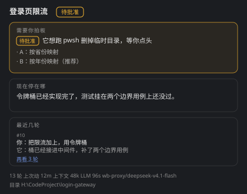

# 接上 · dsh-catchup

> 你切回一个会话，第一句话总是「我刚才干到哪了？」
> 这个插件就是那一句话的答案。

DeepSeek Harness 的右侧栏插件。点一下对话头部的「接上」，右栏打开，**只有三块，从上到下**：

1. **这是什么会话** — 标题；会话声明了 `goal` 就多一行目标
2. **走到哪了** — 最后一轮它自己的说法，加一行事实（轮次 · 上次动 · 上下文）
3. **还有什么悬着** — 每条一句：`批准` / `回答` / `待办`，最多四条

没有历史对话、没有逐轮标题、没有首轮提示词。看完关掉，进去接着干。

**选中面板里任意一句**，浮出「引用」按钮（在选中文本的上方），点一下就把这段作为引用块放进输入框——不发送，光标跟在后面。走的是 DSH 给每个会话级面板都发的 `inputActions.insertQuote(text)`，0 模型调用。



## 哪些免费，哪一步要花钱

**几乎所有东西免费，只有一句要花钱。**

免费的：待拍板的事项（读 DSH 的结构化信号）、运行中 / 未读、轮次、上次活动、选中引用——都是浏览器里已有的数据，**0 token、0 请求**。

要花钱的：**"这摊事到哪了"那一两句**。DSH 本地只存每轮的截断预览（提问 50 字、回答 120 字），没有"结论"这种东西，所以它只能被写一次——**一次小模型调用**，只在你点开面板、且会话有变化时才发生。单次约 ¥0.03–0.06，面板上会显示真实用量和金额。

| | |
|---|---|
| 什么时候调 | **你点开面板时**。Host 比对会话的 `seq` 和缓存里那次摘要的 `seq`，一样就直接回缓存，**一次都不花** |
| 输入 | 会话**开头** + 中途均匀抽样 + **最近**几条，共 24k 字节 |
| 输出 | 一句介绍（稳定）+ 2-4 句现状（含卡点）+ 待定事项，`maxOutputTokens: 5000`（思考也占额度） |
| 模型 | **跟当前会话同款**（读会话自己记录的 `request/header` 路由） |
| 记账 | 面板显示本次 `输入 3.1k / 输出 917 ≈¥0.034`，以及 `累计（全部会话）`；来自 provider 返回的 `usage`，不是估算 |
| 缓存 | `$DSH_HOME/cache/dsh-catchup/<sessionId>.json`，另有 `totals.json` 记总账 |
| 失败 | 30 秒内不重试；面板标「摘要没生成 · 0 token」，悬停看原因 |

可调参数都在 [`cordis.patch.yml`](cordis.patch.yml)。

### 面板上每一块的出处

| 显示的东西 | 来源 | 花 token |
|---|---|---|
| 一句话介绍（没有 goal 时） | 上面那一次调用的 `intro` | 那一次 |
| 现状两三句 | 上面那一次调用的 `now` | 那一次 |
| 悬空事项：待批准 / 它问你的 / 待办 | `pendingInteraction` · `userQuestions` · `todos` 投影 | 0 |
| 运行中 / 未读 | `useSessionStatus()` 实时推送 | 0 |
| 轮次、上次动、上下文 | `sessionStats` / `sessionListMetadata` / `tokenUsage` | 0 |
| 标题 | `session/list` 摘要块 | 0 |
| 用量 `3.8k↑ / 120↓` | 那一次调用的 `usage` | 0 |

面板**只读当前会话**——你切到哪个会话，它讲哪个。不列别的会话。

## 安装

```powershell
plugin_manager install_bundle  <这个目录的绝对路径>
```

装完**重启一次 DSH**（Host 半边是新的模块，HMR 只热更客户端），然后刷新页面：对话头部多一个图标按钮，点它右栏打开；空右栏也会直接显示它的入口。

## 路由

| 位置 | 槽位 | 说明 |
|---|---|---|
| 标签页类型 | `ctx.sidebarRightTabs.register` | id `dsh-catchup`，kind `catchup`，`keepMounted` |
| 面板正文 | `sidebar.right.pane.tab`（key = id） | 全部 UI 在这里 |
| 标签文字 | `sidebar.right.pane.tab.title` | 「接上」 |
| 头部按钮 | `conversation.session.header.utilities` | order −8，**只有图标**（和设计台那个按钮一样），悬停显示说明 |

## 界面

设计源文件在 [`design/catchup.html`](design/catchup.html)：套的是 DSH 官方右侧栏外框，浅色和深色都量过（对比度、字号、点击区、溢出全部通过）。

插件里不写内联样式，而是注入一段前缀化的 `.dsh-catchup` 样式表。灰阶用 `color-mix(in oklab, currentColor …)` 从正文色混出来，所以**不依赖 `data-theme` 属性也能跟着深浅色走**——这个坑躲掉了：DSH 自带的 `--dsh-muted` 在白底只有 3.7:1，直接用会不够对比度。

## 开发

```powershell
npm test          # = node test/logic.test.mjs && node test/render.test.mjs
```

两个测试都不需要浏览器：

- `test/logic.test.mjs` — 从 `lib/client.js` 的 `// #region logic` 切出纯函数单独跑，再查中英词典覆盖、导出文件存在、槽位注册齐全、有没有偷偷混进模型调用或 RPC、`cordis.patch.yml` 是不是合法 YAML。
- `test/render.test.mjs` — 用假 `window.__ModuleLoader__` 真加载 `lib/client.js`，假 React 真渲染组件，检查「待批准 / 等你回答 / 没事等你 / 空会话 / 管线折叠 / 状态行」这几种情况下吐出来的字对不对。

`plugin_manager install_bundle <目录>` 装的是**软链接**（`link:H:/...`），改完源码刷新页面就生效，不用重装。

## 已知限制

- **现状句是截断的**：`turnOutline` 的 response 上限 120 个 UTF-16 单位、空白已折叠，所以读起来是"半句话"，不是完整总结。
- **`todos` 在空闲时是上一轮残留**（新一轮开始时清空），所以它只当兜底信号。
- **待批准只能显示它自己带出来的文字**：`pendingInteraction` 没有公开的 payload 契约，插件是防御式取值的（`title`/`description`/`summary`/`label`/`reason`），取不到就只显示"有东西等你批准"。
- **右栏布局按会话各存一套**：切到没开过这个 tab 的会话，右栏是关着的——这是 DSH 自己的行为，与本插件无关。
- **`approvalState` 浏览器读不到**（host-only，没有 wire），所以"等你批准"只能从 `pendingInteraction` 拿。

## 另一个没做的产品

「跨会话总览看板」——解决"从一堆会话里挑一个切过去"。做过可行性验证但没实现，代价分析和可复用函数都记在 [`docs/ALTERNATIVES.md`](docs/ALTERNATIVES.md)。

## 许可

MIT
